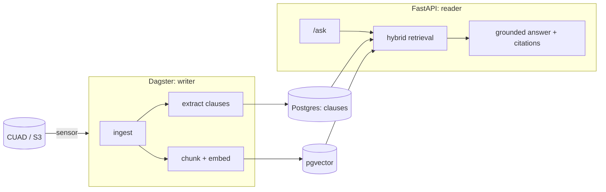

# Contract Intelligence

Structured clause extraction and a hybrid RAG over commercial contracts, built with
hexagonal architecture.

- **Writer side (Dagster):** ingests contracts, extracts typed clauses with an LLM
  map-reduce graph, embeds chunks, and continuously feeds a pgvector index.
- **Reader side (FastAPI):** answers questions by combining clause-type filters with
  vector similarity, citing document and page.
- **Data:** the public [CUAD](https://www.atticusprojectai.org/cuad) contract dataset,
  which also provides lawyer-labelled ground truth for evaluation.

> **Status:** architecture skeleton. Domain model, ports, composition root, executable
> architecture rules, CI and local infrastructure are in place. Ingestion, clause
> extraction, vectorization and the question-answering API arrive in the next changes.



## Architecture

- [Hexagonal architecture: layers, ports, SOLID map](docs/architecture/hexagonal.md)
- [Architecture decision records](docs/architecture/adr/)

The rules are enforced by the build: import contracts (`lint-imports`), `mypy --strict`
conformance of every adapter to its port, and a scan that blocks non-publishable
identifiers.

## Repository layout

| Path | Contents |
|---|---|
| `core/` | `contract_intel`: domain, application (ports and use cases), adapters, composition root |
| `pipelines/` | `contract_intel_pipelines`: Dagster inbound adapter (writer) |
| `rag_api/` | `contract_intel_api`: FastAPI inbound adapter (reader) |
| `core/migrations/` | Alembic migrations |
| `scripts/` | Repository checks |
| `docs/architecture/` | Architecture docs and ADRs |
| `openspec/` | Spec-driven change history (proposals, designs, specs, tasks) |

## Quickstart

Requirements: [uv](https://docs.astral.sh/uv/), Docker with Compose.

```bash
uv sync --all-packages              # Python 3.12 + all workspace packages
cp .env.example .env
docker compose up -d --wait         # Postgres + pgvector, LocalStack S3
uv run alembic upgrade head         # enables the vector extension
uv run pytest                       # unit + architecture tests
uv run lint-imports                 # hexagonal import contracts
```

Run the inbound adapters:

```bash
uv run dagster dev -m contract_intel_pipelines.definitions    # http://localhost:3000
uv run uvicorn contract_intel_api.main:app --reload           # http://localhost:8000/health
```

## Quality gates

| Check | Command |
|---|---|
| Format and lint | `uv run ruff format --check . && uv run ruff check .` |
| Types | `uv run mypy scripts core/src core/tests core/migrations pipelines/src pipelines/tests rag_api/src rag_api/tests` |
| Architecture | `uv run lint-imports` |
| Forbidden identifiers | `uv run python scripts/check_forbidden_identifiers.py` |
| Tests | `uv run pytest` |

All of them run in pre-commit (`uv run pre-commit install`) and in CI.
