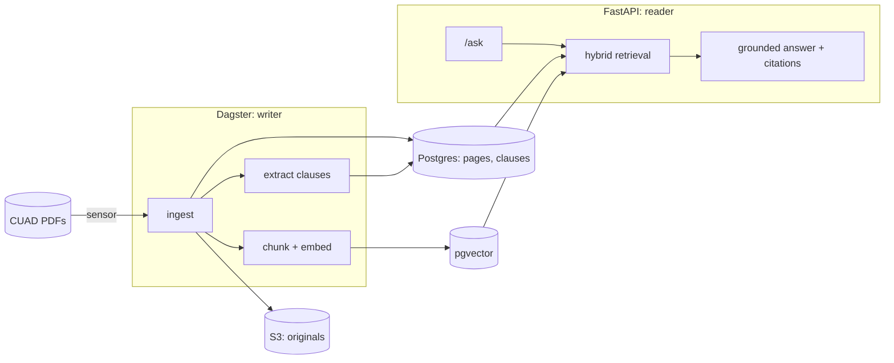

# Contract Intelligence

Typed clause extraction and a hybrid RAG over commercial contracts, built as a
production-shaped system: hexagonal architecture with executable rules, an
orchestrated writer pipeline and a read-only question-answering API.

Reviewing contracts means finding the same things over and over: governing law,
termination rights, liability caps, exclusivity, renewal terms. This project turns a
contract corpus into **structured clause data** you can filter, and lets you **ask
questions** whose answers cite the exact document and page they come from.

- **Writer side (Dagster):** ingests contracts, extracts typed clauses with an LLM
  graph, embeds chunks and continuously feeds a pgvector index.
- **Reader side (FastAPI):** answers questions by combining clause-type filters with
  vector similarity, and grounds every answer in citations.
- **Data:** the public [CUAD](https://www.atticusprojectai.org/cuad) dataset (510
  commercial contracts), which also provides lawyer-labelled ground truth for
  evaluation.

## Status

| Stage | State |
|---|---|
| Hexagonal skeleton, executable architecture rules, CI | Done |
| Document ingestion: CUAD → S3 + per-page text in Postgres, Dagster sensor | Done |
| Clause extraction: LangGraph over pages, typed CUAD clauses, cost tracking | Next |
| Vectorization: chunking, embeddings, pgvector index | Planned |
| RAG API: hybrid retrieval, grounded answers with page citations | Planned |
| Evaluation against CUAD labels (precision/recall per clause type) | Planned |

Each stage is an [OpenSpec](openspec/) change with its proposal, design, spec and
task list; finished ones are archived in `openspec/changes/archive/`.

## Architecture



The two RAG layers are decoupled: Dagster is the **only writer** of the index and
feeds it continuously; the API can only read it, a rule enforced by import contracts
and by the composition root (the reader container has no index writer).

Inside, the code follows **ports and adapters**. Business rules live in a
framework-free core; LLM SDKs, databases, S3, Dagster and FastAPI are adapters at the
edges, wired in a single composition root.

- [Hexagonal architecture: layers, ports, ingestion flow, SOLID map](docs/architecture/hexagonal.md)
- [Architecture decision records](docs/architecture/adr/)

## How it works

### Document ingestion (implemented)

1. `scripts/download_cuad.py` fetches CUAD v1 from its public Zenodo record and
   verifies a pinned SHA-256 before extracting anything.
2. A Dagster sensor runs `DiscoverDocuments`: source documents not ingested yet, in a
   stable order, capped by `CONTRACT_INTEL_INGESTION__MAX_DOCUMENTS` (default 5).
3. Each new document becomes a **dynamic partition** and gets its own run of the
   `ingested_document` asset, which calls `IngestDocument`:
   - stores the original PDF in S3;
   - extracts text page by page (pypdf, no OCR);
   - records the document as `ingested` with its pages, or `failed` with a reason
     (no text layer, unreadable file). Failures stay visible in Dagster and never
     stop other documents.
4. Re-ingesting is idempotent: state and pages are replaced, never duplicated.

### Clause extraction (next)

A LangGraph workflow reads the stored pages and returns clauses typed with the CUAD
taxonomy (governing law, termination for convenience, cap on liability, renewal
term, exclusivity, most favored nation, non-compete, IP assignment, price and volume
restrictions). Outputs are schema-validated, each clause keeps its page range, and
token usage and cost are recorded per document.

### Retrieval and answers (planned)

Pages are chunked and embedded into pgvector. The API filters by clause type and
metadata in SQL, ranks by vector similarity in the same Postgres, and generates an
answer only from the retrieved context, citing document and page.

## Engineering highlights

- **Architecture as tests.** `import-linter` contracts fail the build if the domain
  imports a framework, an inbound adapter touches an outbound adapter, or the API
  imports the index writer.
- **Swappable adapters, verified.** Every outbound port has an in-memory fake; one
  contract suite runs against both the fake and the real adapter (S3, Postgres,
  pypdf, CUAD), so they are interchangeable by construction.
- **Lazy, per-port wiring.** `CONTRACT_INTEL_USE_FAKES` picks fake or real adapters
  port by port; ports without a real adapter yet fail only when resolved.
- **Per-document orchestration.** Dynamic partitions give one run, one retry and one
  lineage entry per contract, ready for downstream assets to chain on.
- **Reproducible data.** Checksum-verified download, atomic extraction, nothing from
  the dataset in git.
- **Publishable by design.** A scanner blocks cloud account ids, internal domains,
  personal emails and a private list of sensitive names in every tracked file.
- **Spec-driven.** Changes go through OpenSpec: behaviour specs first, then design,
  tasks and verification.

## Design decisions

**Why hexagonal architecture?** The LLM stack changes faster than the business rules.
Keeping prompts, SDKs and storage behind ports lets providers change without touching
use cases, and lets every use case be tested with fakes in milliseconds.
See [ADR 0001](docs/architecture/adr/0001-hexagonal-architecture-and-rewrite.md).

**Why separate writer and reader containers?** The index has exactly one writer, so
the API cannot corrupt it and both sides scale and deploy independently.
See [ADR 0003](docs/architecture/adr/0003-composition-root-reader-writer-containers.md).

**Why one Dagster partition per document?** A bad PDF fails its own run, not the
batch; retries are per document; clause extraction and embedding can depend on
ingestion partition by partition.
See [ADR 0005](docs/architecture/adr/0005-per-document-ingestion-with-dynamic-partitions.md).

**Why pgvector instead of a dedicated vector database?** Clauses, pages and vectors
live in one Postgres, so hybrid retrieval is one SQL query with real filters and
joins, and there is a single system to operate.

**Why CUAD?** It is public, realistic (SEC-filed agreements) and annotated by lawyers
for 41 clause categories, which makes extraction measurable instead of anecdotal.

**Why a `uv` workspace?** One lockfile for three packages, so the API never installs
Dagster and the pipelines never install FastAPI.
See [ADR 0002](docs/architecture/adr/0002-uv-workspace-monorepo.md).

## Tech stack

| Concern | Choice |
|---|---|
| Language and tooling | Python 3.12, `uv` workspace, ruff, mypy `--strict`, pytest |
| Orchestration (writer) | Dagster: dynamic partitions, sensors |
| API (reader) | FastAPI |
| Storage | Postgres 16 + pgvector, S3 (LocalStack locally) |
| Persistence | SQLAlchemy 2 async, Alembic |
| Documents | pypdf |
| Wiring | dependency-injector, pydantic-settings |
| LLM layer | LangGraph, OpenAI (arrives with clause extraction) |
| Architecture rules | import-linter |
| Planning | OpenSpec |

## Quickstart

Requirements: [uv](https://docs.astral.sh/uv/), Docker with Compose.

```bash
uv sync --all-packages                   # Python 3.12 + all workspace packages
cp .env.example .env
uv run python scripts/download_cuad.py   # CUAD v1 (~100 MB, SHA-256 verified) into data/cuad/
docker compose up -d --wait              # Postgres + pgvector, LocalStack S3
uv run alembic upgrade head              # vector extension, documents and pages tables
uv run pytest                            # unit, contract (fakes) and architecture tests
uv run pytest -m integration             # contract tests against Postgres and LocalStack
```

> `pytest -m integration` truncates the `documents` table of the local database.

Run the inbound adapters:

```bash
# Real ingestion: set CONTRACT_INTEL_USE_FAKES=false in .env first (dagster dev loads .env,
# which overrides shell variables); the sensor then schedules the first
# CONTRACT_INTEL_INGESTION__MAX_DOCUMENTS (5) documents.
uv run dagster dev -m contract_intel_pipelines.definitions    # http://localhost:3000
uv run uvicorn contract_intel_api.main:app --reload           # http://localhost:8000/health
```

Inspect the result:

```bash
docker compose exec postgres psql -U contract_intel -c \
  "SELECT status, count(*), sum(page_count) FROM documents GROUP BY status"
docker compose exec localstack awslocal s3 ls s3://contracts/raw/
```

## Configuration

Settings are read from `CONTRACT_INTEL_*` variables or `.env` (see
[`.env.example`](.env.example)); nested sections use `__`.

| Variable | Default | Purpose |
|---|---|---|
| `CONTRACT_INTEL_USE_FAKES` | `true` | In-memory adapters (no infrastructure) or real ones |
| `CONTRACT_INTEL_INGESTION__MAX_DOCUMENTS` | `5` | How many CUAD contracts the demo ingests (up to 510) |
| `CONTRACT_INTEL_INGESTION__CUAD_DIR` | `data/cuad/CUAD_v1/full_contract_pdf` | Local CUAD PDFs |
| `CONTRACT_INTEL_DATABASE__URL` | local Postgres | Async SQLAlchemy URL |
| `CONTRACT_INTEL_STORAGE__BUCKET` / `__ENDPOINT_URL` | `contracts` / LocalStack | Where originals are stored |
| `CONTRACT_INTEL_LLM__API_KEY` | empty | LLM provider key (clause extraction onwards) |

## Testing strategy

| Layer | What it proves | Needs |
|---|---|---|
| Domain | Invariants of entities and value objects | nothing |
| Use cases | Business behaviour, using in-memory fakes of every port | nothing |
| Contract | Fake and real adapter behave the same (LSP) | Docker for S3/Postgres cases (`-m integration`) |
| Architecture | Import contracts hold; a forbidden import makes them fail | nothing |
| Pipelines | Sensor scheduling and asset outcomes with an ephemeral Dagster instance | nothing |

## Quality gates

| Check | Command |
|---|---|
| Format and lint | `uv run ruff format --check . && uv run ruff check .` |
| Types | `uv run mypy scripts core/src core/tests core/migrations pipelines/src pipelines/tests rag_api/src rag_api/tests` |
| Architecture | `uv run lint-imports` |
| Forbidden identifiers | `uv run python scripts/check_forbidden_identifiers.py` |
| Tests | `uv run pytest` and `uv run pytest -m integration` |

All of them run in pre-commit (`uv run pre-commit install`) and in CI, where a
separate job runs the integration tests against Postgres and LocalStack services.

## Repository layout

| Path | Contents |
|---|---|
| `core/` | `contract_intel`: domain, application (ports and use cases), adapters, composition root |
| `pipelines/` | `contract_intel_pipelines`: Dagster inbound adapter (writer) |
| `rag_api/` | `contract_intel_api`: FastAPI inbound adapter (reader) |
| `core/migrations/` | Alembic migrations |
| `scripts/` | Dataset download and repository checks |
| `docs/architecture/` | Architecture docs and ADRs |
| `openspec/` | Spec-driven change history (proposals, designs, specs, tasks) |

## Data and attribution

Contracts come from the **Contract Understanding Atticus Dataset (CUAD) v1** by
[The Atticus Project](https://www.atticusprojectai.org/cuad), licensed under
[CC BY 4.0](https://creativecommons.org/licenses/by/4.0/) and described in
Hendrycks et al., *CUAD: An Expert-Annotated NLP Dataset for Legal Contract Review*
(NeurIPS 2021). The dataset is downloaded locally and never committed.

## Author

**Luis Ramirez**: AI engineering, architecture and implementation.
