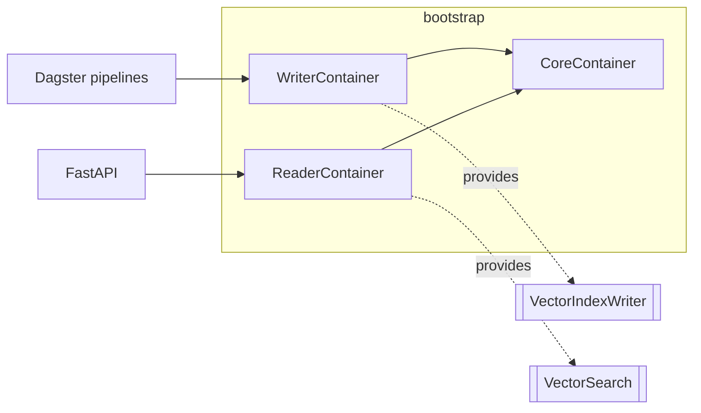

# ADR 0003 — Composition root with separate reader and writer containers

- **Status:** Accepted
- **Date:** 2026-11-09

## Context

The RAG is split in two decoupled layers:

- **Writer** — the Dagster pipelines ingest documents, extract clauses, embed chunks
  and continuously feed the vector index;
- **Reader** — the API retrieves from the index and generates answers. It must never
  write to the index.

Adapters must be chosen in exactly one place, and tests must be able to replace any
of them.

## Decision

- All wiring lives in `contract_intel.bootstrap` using `dependency-injector`:
  - `CoreContainer` — settings and adapters shared by both sides (vector store
    connection, embedder, contract repository, usage tracker);
  - `WriterContainer` — adds document source/storage, text and clause extractors and
    the **`VectorIndexWriter`**;
  - `ReaderContainer` — adds **`VectorSearch`** and the answer generator, and exposes
    no index writer at all.
- Index access is split in two ports (`VectorIndexWriter`, `VectorSearch`) instead of
  one "vector store" port.
- Providers are lazy: building a container performs no I/O.
- Settings come from `pydantic-settings` (`CONTRACT_INTEL_*` variables).
- Until real adapters exist, the containers wire the in-memory adapters; asking for
  real adapters fails fast with an explicit error.

## SOLID rationale

- **DIP** — use cases depend on ports; only the composition root knows concretions.
- **ISP** — the reader receives a search-only port; it cannot even reach writes.
- **SRP** — inbound adapters translate requests; they never construct adapters.

## Alternatives considered

- **Hand-written factory functions** (the prototype's approach). Hard to override in
  tests and easy to bypass.
- **FastAPI `Depends` / Dagster resources as the wiring mechanism.** Couples
  composition to each inbound framework and duplicates it across the two processes.

## Consequences

- Tests override providers (`container.<provider>.override(...)`) instead of patching
  imports.
- `dependency-injector` is a runtime dependency of `core`, confined to `bootstrap`
  (import contracts forbid it in `domain` and `application`).
