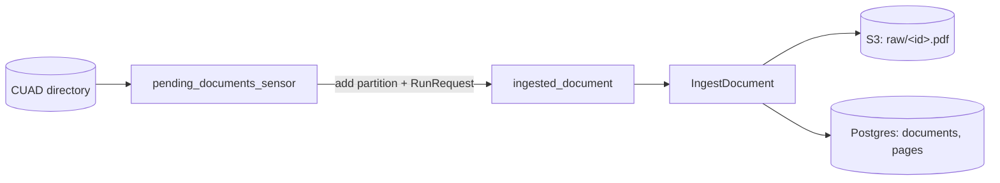

# ADR 0005 — Per-document ingestion with dynamic partitions

- **Status:** Accepted
- **Date:** 2026-11-09

## Context

The writer side must keep feeding the system as contracts appear at the source. The
scaffold declared a batch inbound port (`IngestDocuments.execute() -> report`), while
the next steps (`ExtractClauses`, `VectorizeDocument`) already work on one
`DocumentId`. With a batch, one bad file fails the whole run, retries are
all-or-nothing, and downstream steps cannot be chained per document.

## Decision

- Replace the batch port with two inbound ports:
  - `DiscoverDocuments` — ids of source documents not ingested yet, in a
    deterministic order (by id) and capped by `ingestion.max_documents`;
  - `IngestDocument` — store the original, extract pages and record an
    `IngestionRecord` (`ingested` with pages, or `failed` with a reason).
- Record ingestion state and pages behind a new outbound port, `DocumentRepository`
  (Postgres tables `documents` and `pages`).
- In Dagster, every document is a key of the dynamic partition set `documents`:
  - `pending_documents_sensor` runs `DiscoverDocuments`, adds the keys that are not
    partitions yet and requests one run per new key;
  - the partitioned asset `ingested_document` runs `IngestDocument` and raises
    `Failure` after a failed record is persisted.
- Business failures (no text layer, unreadable PDF) are data, not exceptions: they
  end as failed records and stay visible in Dagster.

## SOLID rationale

- **SRP** — discovering what is missing and processing one document change for
  different reasons and live in different use cases.
- **ISP** — the sensor only sees `DiscoverDocuments`; the asset only `IngestDocument`.
- **DIP** — the "no extractable text means failed" rule lives in the domain, so a new
  extractor cannot change it.

## Alternatives considered

- **Keep the batch port behind one unpartitioned asset or schedule.** Simpler, but no
  per-document visibility, retry or downstream chaining.
- **Re-extract text on every downstream step instead of persisting pages.** Less
  storage, but repeated work and no catalogue of ingestion state.

## Consequences

- A failed document is never rescheduled automatically (its partition already
  exists); re-materializing it in Dagster retries it.
- Clause extraction and vectorization add assets partitioned by `documents` that
  depend on `ingested_document`.
- The demo size is one setting (`CONTRACT_INTEL_INGESTION__MAX_DOCUMENTS`, default 5).
