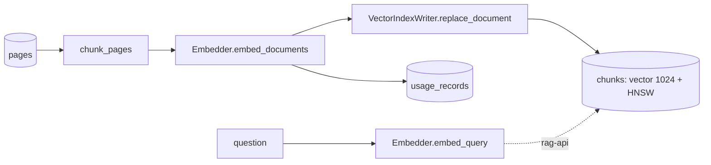

# ADR 0007 — Embeddings with Voyage AI, index in pgvector

- **Status:** Accepted
- **Date:** 2026-11-09

## Context

The RAG needs every ingested contract split into retrievable chunks that keep their
page location, embedded, and stored in an index the API can search. Generation will
use Claude, but Anthropic does not offer an embeddings model, so embeddings need a
separate provider. Contracts are legal text, and the demo must stay cheap.

## Decision

- **Embeddings:** Voyage AI `voyage-law-2` (1024 dimensions, 16K-token context),
  a model trained for legal text and the provider Anthropic recommends. Documents are
  encoded with `input_type="document"` and questions with `input_type="query"`; the
  `Embedder` port exposes `embed_documents` and `embed_query` accordingly.
  `truncation=False`, so an over-long text fails instead of being cut silently.
- **Index:** pgvector in the same Postgres as pages and clauses: table `chunks` with
  a `vector(1024)` column and an HNSW index (`vector_cosine_ops`).
- **Chunking:** a pure domain function splits the page text into windows of at most
  2,000 characters with 200 characters of overlap, cutting at paragraph, line or word
  boundaries; each chunk records the page range it covers.
- **Consistency:** `VectorIndexWriter.replace_document` deletes and inserts a
  document's chunks in one transaction, and embeddings are computed before the index
  is touched, so readers never see a half-indexed document.
- **Cost tracking:** each vectorization writes a `usage_records` row (model, tokens,
  estimated cost at list price, document); the same table will hold Claude usage.
- **Composition:** the composition root is split into `bootstrap/core.py`,
  `writer.py` and `reader.py`, so the API process never imports writer code (and the
  import contract forbids it).

## SOLID rationale

- **SRP** — chunking is domain logic; adapters only talk to Voyage or Postgres.
- **ISP** — document and query embedding are separate methods; the reader only needs
  queries, the writer only documents.
- **OCP / DIP** — another embeddings provider is a new adapter behind `Embedder`.

## Alternatives considered

- **OpenAI embeddings** — fine quality, but a general model and a second LLM vendor
  next to Claude.
- **A local model (sentence-transformers)** — free and offline, but weaker on legal
  retrieval and heavier to ship.
- **A dedicated vector database** — one more system to run, and filters by clause
  type would need data duplicated outside Postgres.
- **One chunk per page** — CUAD pages range from a few dozen to thousands of
  characters; uneven chunks hurt retrieval.

## Consequences

- `CONTRACT_INTEL_EMBEDDINGS__API_KEY` is required in real mode; tests use fakes and
  a smoke test marked `voyage` runs only with a real key.
- The vector dimension is fixed by migration `0003`; changing models requires a new
  migration and re-indexing.
- All of CUAD is about 6.7M tokens, within the 50M free tokens of `voyage-law-2`.
