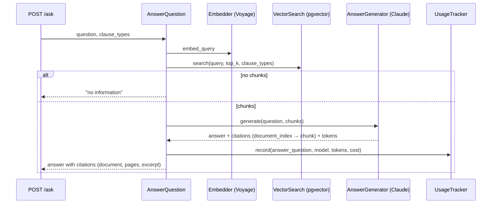

# ADR 0008 — Grounded answers with Claude citations

- **Status:** Accepted
- **Date:** 2026-11-09

## Context

The API must answer questions about the indexed contracts using only what the index
returns, and every statement has to be traceable to a document and its pages. Answers
come from an LLM, which can hallucinate both facts and references. Providers also
fail in ordinary ways (rate limits, outages, refusals) that the API has to report
clearly.

## Decision

- **Flow** (`AnswerQuestionUseCase`): embed the question (`Embedder.embed_query`),
  retrieve the `top_k` most similar chunks (`VectorSearch`, cosine similarity on the
  pgvector HNSW index, optional clause-type filter), and ask the `AnswerGenerator`.
  With no chunks, answer "no information" without calling the model.
- **Generator:** Claude through the official Anthropic SDK
  (`AnthropicAnswerGenerator`, default `claude-sonnet-5-5`, configurable). Each
  retrieved chunk is sent as a `document` content block with **citations enabled**;
  the API returns which document block supports each part of the answer, and
  `document_index` maps back to the chunk, hence to document and page range. The
  system prompt restricts Claude to the provided documents and requires saying when
  they do not contain the answer.
- **Defense in depth:** the use case drops any citation that does not fall inside a
  retrieved chunk.
- **Cost:** the port returns `GeneratedAnswer` (answer, model, input and output
  tokens); the use case records a `usage_records` row priced with `TokenPricing`.
- **Provider errors as domain errors:** adapters translate SDK exceptions into
  `ProviderRateLimitedError`, `ProviderUnavailableError` and `AnswerRefusedError`;
  `POST /ask` maps them to 503 (with `Retry-After` for rate limits) and 422.
- **Refusal fallback:** server-side `fallbacks: "default"` is available behind
  `CONTRACT_INTEL_LLM__FALLBACKS` (off by default); a refusal that remains is an
  explicit error.

## SOLID rationale

- **SRP** — the router translates HTTP, the use case orchestrates, adapters talk to
  providers; nobody else knows prices or SDK exceptions.
- **DIP / OCP** — another model or provider is a new `AnswerGenerator` adapter.
- **ISP** — the API reaches only `VectorSearch`; index writes stay unreachable.

## Alternatives considered

- **Asking for JSON with citations (structured outputs).** Citations are verbatim
  and tied to the source blocks by the API itself; JSON references can be invented,
  and citations are incompatible with structured output format anyway.
- **LangChain for generation.** A single call needs no orchestration; LangGraph is
  reserved for multi-step clause extraction.
- **A similarity threshold to skip irrelevant context.** Deferred until there is a
  retrieval evaluation; the prompt already forces "no information" answers.

## Consequences

- Each question costs one Voyage request and one Claude request (about $0.02 with
  Sonnet 5.5 and 8 chunks); Voyage's free tier caps the API at 3 questions a minute.
- Clause-type filtering works now and becomes useful once clause extraction fills
  `chunks.clause_type`.
