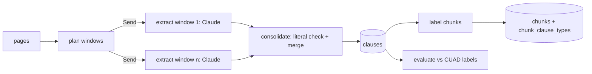

# ADR 0009 — Clause extraction: map-reduce with LangGraph and Claude

- **Status:** Accepted
- **Date:** 2026-11-10

## Context

Contracts must be queryable by clause type (governing law, termination, liability
cap, ...), and `/ask` already accepts a `clause_types` filter. Clauses have to be
verbatim and located by page, and the extraction quality must be measured, not
assumed. CUAD ships lawyer labels for every contract (`master_clauses.csv`).

## Decision

- **Port and use case:** `ClauseExtractor.extract(document, pages) ->
  ClauseExtraction` (clauses, model, tokens). `ExtractClausesUseCase` stores the
  clauses in the document's contract (replacing that document's previous clauses)
  and records tokens and cost in `usage_records`.
- **Adapter:** `LangGraphClauseExtractor`, a map-reduce `StateGraph`:
  1. pages are grouped into windows of whole pages (`window_chars`, default 24,000);
  2. one branch per window (LangGraph `Send`, run in parallel) calls Claude
     (`messages.parse` with a Pydantic schema: type, verbatim text, first/last page);
  3. a deterministic reduce applies domain rules: a candidate survives only if its
     text appears literally (up to whitespace) in the pages it claims, and same-type
     candidates whose texts overlap are merged.
- **Chunk labels:** `Chunk.clause_types` is a set. At vectorization, a pure domain
  rule labels each chunk with every clause type whose clause shares pages and text
  with it; labels live in `chunk_clause_types` and `PgVectorSearch` filters with
  `EXISTS`.
- **Order:** the per-document Dagster job runs ingest → extract → index, so chunks are
  born labelled; if extraction fails, indexing is skipped until a retry.
- **Evaluation:** `EvaluateClauseExtractionUseCase` compares stored clauses with the
  lawyer labels (`GroundTruthSource`, adapter `CuadGroundTruth`): precision, recall
  and F1 of clause presence per type, plus whether the extracted text overlaps the
  lawyers' excerpts. It runs as the Dagster asset `extraction_evaluation` and as
  `scripts/evaluate_extraction.py`, without calling the model.

## SOLID rationale

- **SRP** — orchestration (graph), model call (adapter) and rules (domain) are
  separate; the use case owns persistence and cost.
- **OCP / DIP** — another extraction strategy is another `ClauseExtractor`.
- **LSP** — the in-memory extractor and the LangGraph one pass the same contract
  suite.

## Alternatives considered

- **One call with the whole contract.** Simpler, but long contracts dilute attention
  and nothing runs in parallel; with short contracts the graph makes a single call
  anyway.
- **An LLM reduce step.** More cost and nondeterminism; the deterministic merge is
  reproducible and testable.
- **One clause type per chunk.** Loses information: a 2,000-character chunk often
  mixes clauses.

## Consequences

- Reference run on 3 CUAD contracts (Sonnet 5.5): 12 clauses, $0.078 in total;
  micro precision 73%, recall 100%, F1 84%, 88% of true positives with text matching
  the lawyers' excerpts. Three documents make these numbers illustrative, not
  statistically meaningful.
- A Claude outage or refusal blocks indexing of that document until it is retried.
- The taxonomy (10 CUAD categories) can grow without changing the architecture.
