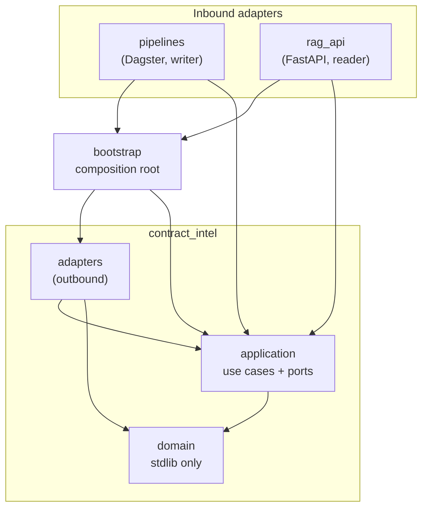

# Hexagonal architecture

This system follows **ports and adapters**. Business rules live in the centre and know
nothing about LLM SDKs, databases, Dagster or FastAPI; those are plugged in at the
edges. The rules below are enforced by the build (see
[ADR 0004](adr/0004-executable-architecture-rules.md)).

## Layers and dependency direction



Arrows point from the dependent module to its dependency. Every dependency points
inward:

- `domain` depends on nothing but the standard library;
- `application` depends only on `domain`;
- `adapters` implement `application` ports;
- `bootstrap` is the only place that creates adapters;
- inbound adapters obtain use cases from `bootstrap` and never touch outbound adapters.

## Repository layout

```
core/src/contract_intel/
  domain/                 Contract, Document, Page, PageRange, Clause, ClauseType,
                          Chunk, Embedding, ScoredChunk, Citation, Answer, UsageRecord
  application/
    ports/inbound/        what the system offers (one Protocol per module)
    ports/outbound/       what the system needs (one Protocol per module)
    use_cases/            implementations of inbound ports
  adapters/outbound/
    in_memory/            deterministic adapters for tests and offline runs
    persistence/          SQLAlchemy declarative base
  bootstrap/              settings + Core/Writer/Reader containers
core/migrations/          Alembic (deployment tooling, outside the runtime package)
pipelines/src/contract_intel_pipelines/   Dagster definitions
rag_api/src/contract_intel_api/           FastAPI application
```

## Ports

| Port | Direction | Purpose | In-memory adapter | Production adapter (planned) |
|---|---|---|---|---|
| `IngestDocuments` | inbound | Bring new documents into storage | — | use case |
| `ExtractClauses` | inbound | Extract and persist typed clauses | — | use case |
| `VectorizeDocument` | inbound | Chunk, embed and index a document | — | use case |
| `AnswerQuestion` | inbound | Answer a question with citations | — | use case |
| `DocumentSource` | outbound | Where documents come from | `InMemoryDocumentSource` | CUAD dataset source |
| `DocumentStorage` | outbound | Durable raw files | `InMemoryDocumentStorage` | S3 |
| `TextExtractor` | outbound | Per-page text | `InMemoryTextExtractor` | pypdf + OCR fallback |
| `ClauseExtractor` | outbound | Typed clauses from pages | `InMemoryClauseExtractor` | LangGraph map-reduce |
| `Embedder` | outbound | Text → vectors | `InMemoryEmbedder` | OpenAI embeddings |
| `VectorIndexWriter` | outbound | Write side of the index (pipelines only) | `InMemoryVectorIndexWriter` | pgvector |
| `VectorSearch` | outbound | Read side of the index (API only) | `InMemoryVectorSearch` | pgvector |
| `ContractRepository` | outbound | Contract aggregates | `InMemoryContractRepository` | Postgres |
| `AnswerGenerator` | outbound | Grounded answer from context | `InMemoryAnswerGenerator` | OpenAI chat |
| `UsageTracker` | outbound | Token and cost accounting | `InMemoryUsageTracker` | Postgres |

## SOLID map

| Principle | Where it shows |
|---|---|
| **S**ingle responsibility | One use case per inbound port; adapters translate and hold no business rules; each deployable owns one framework. |
| **O**pen/closed | New providers are new adapters registered in `bootstrap`; use cases do not change. |
| **L**iskov substitution | In-memory and production adapters satisfy the same `Protocol` and are swapped without touching consumers (conformance test). |
| **I**nterface segregation | Small ports; the index is split into `VectorIndexWriter` and `VectorSearch`, so the API cannot write. |
| **D**ependency inversion | `application` declares the abstractions; adapters depend on them; only `bootstrap` knows concretions. |

## How to add a port and an adapter

1. Declare the port in `application/ports/outbound/<name>.py` as a
   `@runtime_checkable` `Protocol` using domain types only.
2. Add an in-memory adapter in `adapters/outbound/in_memory/<name>.py` and register
   it in `core/tests/adapters/in_memory/test_conformance.py`.
3. Write the use case against the port and test it with the in-memory adapter.
4. Implement the production adapter in `adapters/outbound/<technology>/` and run the
   same behaviour tests against it (contract tests).
5. Wire it in `bootstrap/containers.py`: the writer container, the reader container
   or the shared core.
6. If the adapter brings a new SDK, add it to the framework-free lists in
   `[tool.importlinter]`.

## Related decisions

- [ADR 0001 — Hexagonal architecture and a clean rewrite](adr/0001-hexagonal-architecture-and-rewrite.md)
- [ADR 0002 — `uv` workspace monorepo](adr/0002-uv-workspace-monorepo.md)
- [ADR 0003 — Composition root with reader and writer containers](adr/0003-composition-root-reader-writer-containers.md)
- [ADR 0004 — Executable architecture rules](adr/0004-executable-architecture-rules.md)
